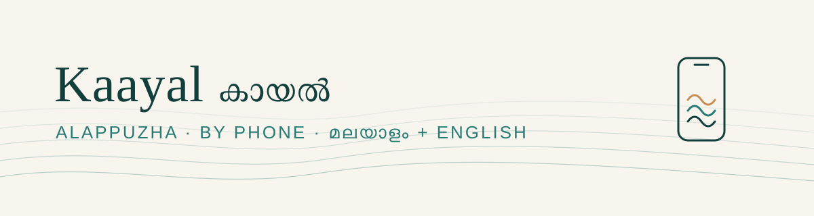

# Kaayal (കായൽ)

Malayalam-first, voice-first tourism assistant for Alappuzha. **Paayal** — Kaayal's AI voice assistant — answers calls on a Sarvam-hosted number, describes verified boat operators, takes consented booking *inquiries* (never confirmations), and calls customers back when operators or boats become available.

**Live prototype:** `https://kaayal.glitchy.systems` (Cloudflare tunnel → local FastAPI). `STATUS.md` tracks what's live and pending.

## Quick start (Docker Compose)

Everything — the FastAPI app **and** the WhatsApp demo bot — runs as one stack:

```bash
cp starter/.env.example starter/.env   # fill in the values below
docker compose up -d --build
docker compose logs -f wa-bot          # scan the QR it prints (WhatsApp → Linked Devices)
```

- App: `http://localhost:8000` (site, portal, admin, voice-tool API). SQLite persists in the `kaayal-data` volume.
- wa-bot: persists its paired WhatsApp session in the `wa-session` volume — QR pairing is one-time unless you wipe the volume.
- Optional public ingress via Cloudflare: `TUNNEL_TOKEN=<token> docker compose --profile tunnel up -d` (or keep running cloudflared on the host).

### Required `starter/.env` values

| Key | What |
|---|---|
| `OPENAI_API_KEY` | Free-form answer tool (`voice_reply` only) |
| `SARVAM_TOOL_SHARED_SECRET` | Auth token for tool endpoints + wa-bot |
| `ADMIN_TOKEN` | `/admin?t=…` dashboard access |
| `KAAYAL_PUBLIC_BASE_URL` | e.g. `https://kaayal.glitchy.systems` |
| `KAAYAL_PHONE_NUMBER` | `+91 7965861153` — Paayal's line |
| `KAAYAL_WHATSAPP_NUMBER` | `+91 9400354625` — operator onboarding |

Optional: `SIM_CALLBACK_OUTCOME`, `DEMO_IGNORE_CALL_WINDOW` (demo controls — see `starter/.env.example`).

## Local development (no Docker)

```bash
cd starter && uv sync
.venv/bin/python -m pytest -q                    # 121 tests
.venv/bin/python -m uvicorn app.main:app --port 8000

cd wa-bot && npm install && npm start            # QR pairs the WhatsApp demo
```

## Architecture

```
Caller → Sarvam number → Paayal (Sarvam voice agent: STT→LLM→TTS)
   ├─ tool:voice_reply            → FastAPI → OpenAI Responses API (free-form answers only)
   ├─ tool:list_boats/get_boat    → FastAPI → SQLite (verified catalog)
   ├─ tool:create_booking_request → FastAPI → inquiry row → operator portal
   └─ tool:create_callback_request → FastAPI → callback queue → event engine
        → outbound provider (simulator today; Sarvam adapter stubbed, off by default)

WhatsApp DM → wa-bot (open-wa demo) → /api/ops/wa_onboard → pending operator
```

- `starter/app/` — FastAPI + SQLModel/SQLite: catalog, requests, callbacks engine, portal, admin, site, wa-onboard, pii
- `starter/wa-bot/` — open-wa WhatsApp onboarding demo (**unofficial API, demo only**)
- `starter/docs/` — Sarvam setup, demo runbook, operator onboarding, design system
- `pack-claude/` — research/content pack from the strategy team (Phase-1-era; live truth wins)
- `.devin/skills/` — UI/design skills; `AGENTS.md` files carry the working rules

## Demonstrate

`starter/docs/demo-runbook.md` — seed demo data from `/admin`, then walk the full tourist → callback → operator journey.

**Honesty rules:** booking requests are inquiries the operator confirms by phone; demo data is labeled DEMO; the outbound dialer is simulated (no real calls); WhatsApp onboarding is an unofficial-API demo. No payments, eKYC, or real outbound calls without owner approval.
